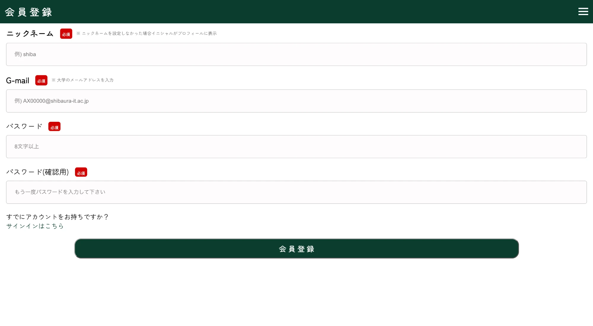
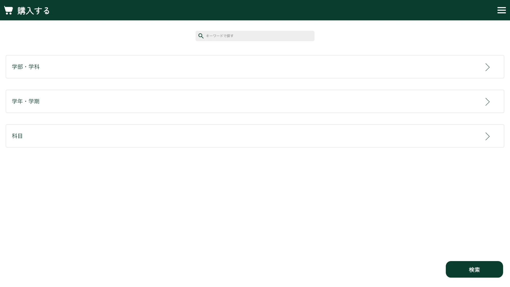
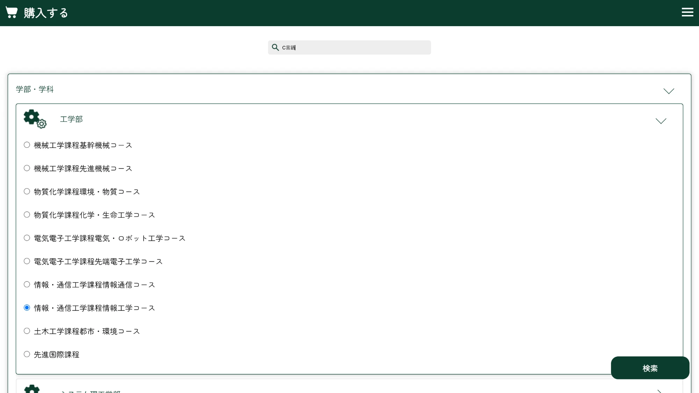
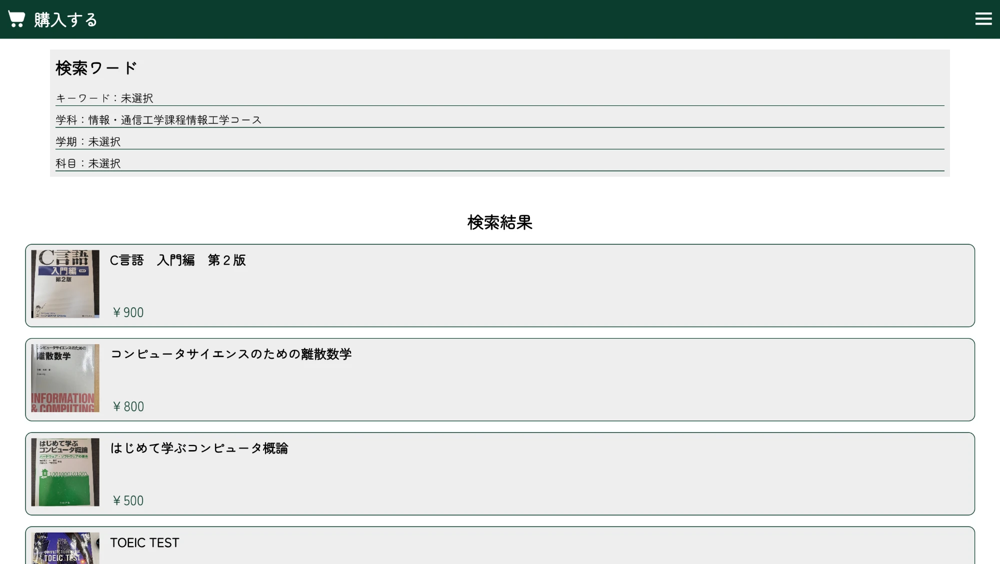
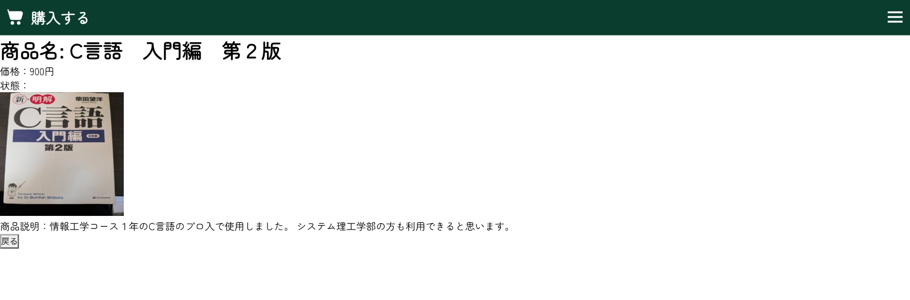
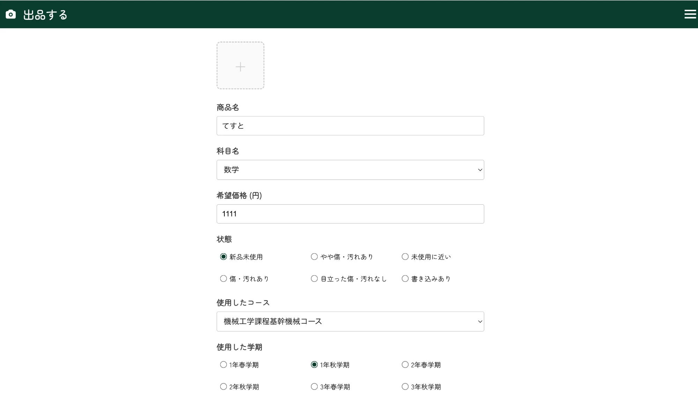

# SIT_freemarket

芝浦工業大学の学生どうしで、授業で使う教科書を売り買いするための学内専用フリマ Web アプリ。

> **現在の状態**: 学内の学生向けに公開しています（大学のメールアドレスでのみ登録可能なため、学外からは利用できません）。
> 現在は大学から許可を得て運用するための準備中です。決済方法などは大学に確認をとってから実装するため、
> **購入の申請から取引完了までの流れ（購入フロー）以降の機能はまだ実装していません。**

## 概要

授業の教科書は学部・学科・学年・学期によって決まっていて、先輩が使い終えた教科書を後輩が必要とする、という需要が学内で完結しています。
一般のフリマサービスでは「どの授業の教科書か」で探しにくく、同じ大学の学生どうしでもやり取りは配送が前提になります。

このアプリは、利用者を大学のメールアドレス（`@shibaura-it.ac.jp`）で登録した学生に限定し、
学部・学科 / 学年・学期 / 科目で教科書を探せるようにし、受け渡しはキャンパス（豊洲・大宮）での手渡しも選べるようにしています。

## 画面

学外からは利用できないため、画面はスクリーンショットで紹介します。

<table>
  <tr>
    <th>1. 大学のメールアドレスで会員登録</th>
    <th>2. 教科書を探す</th>
  </tr>
  <tr>
    <td width="50%"></td>
    <td width="50%"></td>
  </tr>
  <tr>
    <td>登録できるのは <code>@shibaura-it.ac.jp</code> のアドレスだけ。画面と DB の両方で確認している</td>
    <td>キーワードに加えて、学部・学科 / 学年・学期 / 科目で絞り込める</td>
  </tr>
  <tr>
    <th>3. 学部・学科で絞り込む</th>
    <th>4. 検索結果</th>
  </tr>
  <tr>
    <td width="50%"></td>
    <td width="50%"></td>
  </tr>
  <tr>
    <td>キーワードと組み合わせて、自分のコースを選ぶだけで候補が絞れる（授業の教科書は学科ごとに決まっているため）</td>
    <td>選んだ条件と、該当する教科書が並ぶ。条件は URL に保存され、詳細から戻っても消えない</td>
  </tr>
  <tr>
    <th>5. 商品の詳細</th>
    <th>6. 出品する</th>
  </tr>
  <tr>
    <td width="50%"></td>
    <td width="50%"></td>
  </tr>
  <tr>
    <td>価格・画像に加えて、出品者が「どの授業で使ったか」を書ける</td>
    <td>科目・使用したコース・学期を選んで出品する。ここで選んだ内容が、検索の絞り込みに使われる</td>
  </tr>
</table>

## 主な機能

- **会員登録・ログイン**: 大学のメールアドレスのみ登録可能。ニックネームを設定
- **教科書の検索**: キーワードと、学部・学科 / 学年・学期 / 科目の絞り込み。検索条件は URL に保存し、詳細ページから戻っても復元される
- **商品詳細**: 商品名・価格・状態・説明・画像
- **出品**: 画像（最大5枚）、商品名、価格、科目、状態、コース、学期、受け渡し方法（豊洲キャンパス・大宮キャンパス・郵送）、説明
- **ルート保護**: 未ログインで購入・出品・商品詳細を開くと、ログイン画面に移動する

購入の申請・取引の完了と、それに続くマイページ（出品・購入履歴）は、決済方法などを大学に確認してから実装する予定です。いいね・ログアウトも `main` には未反映です。進捗は [`PROGRESS.md`](PROGRESS.md) にまとめています。

## 技術構成

| 領域 | 技術 |
|---|---|
| フロントエンド | Next.js（App Router）、React、TypeScript、CSS Modules、GSAP（アニメーション） |
| 認証・DB・画像 | Supabase（Auth / PostgreSQL / Storage）、`@supabase/ssr` |
| ホスティング | Vercel |

```
ブラウザ
  └─ Next.js（Vercel）
       ├─ middleware.ts   Supabase のセッションを確認し、未ログインならログイン画面へ
       └─ 各画面          Supabase クライアントから直接読み書き
            ├─ Auth       会員登録・ログイン
            ├─ PostgreSQL profiles / merchandises など
            └─ Storage    商品画像（images バケット）
```

- 専用の API サーバーは持たず、画面から Supabase を直接呼び出す構成です。データへのアクセス制御は Supabase の Row Level Security（RLS）で行う前提です
- セキュリティ面の確認結果と対応状況は [`SECURITY_REVIEW.md`](SECURITY_REVIEW.md) にまとめています

## ディレクトリ構成

```
middleware.ts                 ルート保護
src/
├── app/
│   ├── signin/ signup/       ログイン・会員登録
│   ├── purchase/             教科書の検索（ログイン後のホーム）
│   ├── merchandises/[id]/    商品詳細
│   ├── sell/                 出品
│   ├── components/           ヘッダー・フォーム・カテゴリ選択などの UI 部品
│   └── _validationFunctions/ 入力チェック
└── utils/supabase/           Supabase クライアント（ブラウザ用・middleware 用）
```

## 開発環境の構築

前提: Node.js 20 以上、Supabase プロジェクト

```bash
npm install
cp .env.example .env.local   # Supabase の URL と anon key を設定する
npm run dev                  # http://localhost:3000
```

| 環境変数 | 用途 |
|---|---|
| `NEXT_PUBLIC_SUPABASE_URL` | Supabase の Project URL |
| `NEXT_PUBLIC_SUPABASE_ANON_KEY` | Supabase の anon public key |

DB のテーブル定義と RLS ポリシー、Storage のバケット設定はリポジトリに含まれていないため、Supabase のダッシュボードで用意する必要があります。

## 関連ドキュメント

| ファイル | 内容 |
|---|---|
| [`ARCHITECTURE.md`](ARCHITECTURE.md) | 構成の詳細 |
| [`FUNCTIONS.md`](FUNCTIONS.md) | 関数・コンポーネントのリファレンス |
| [`PROGRESS.md`](PROGRESS.md) | 実装済み・未実装の機能、既知の問題 |
| [`SECURITY_REVIEW.md`](SECURITY_REVIEW.md) | セキュリティレビューと対応状況 |
